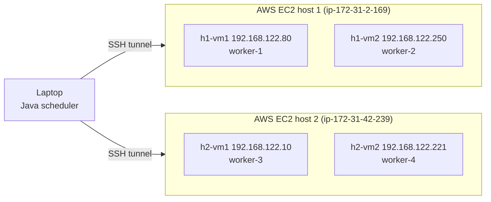
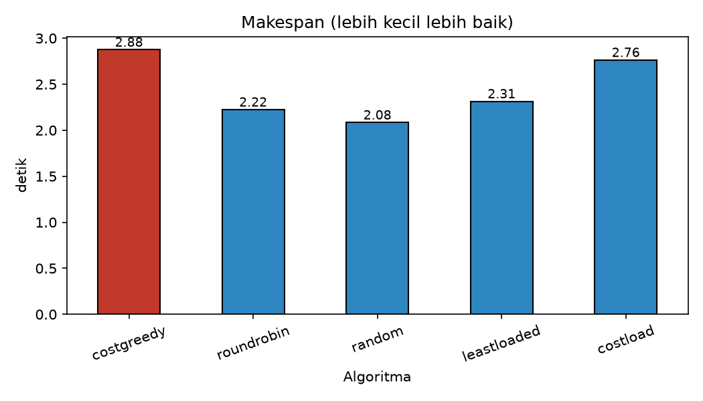
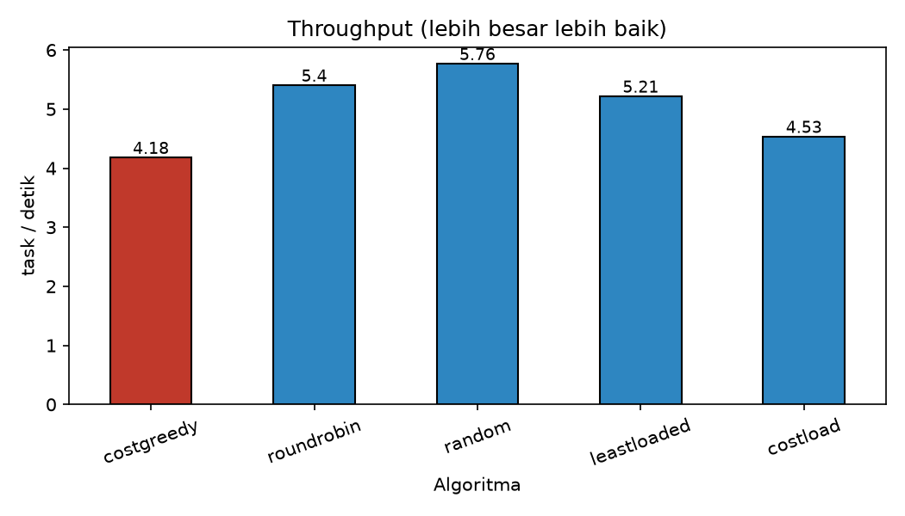
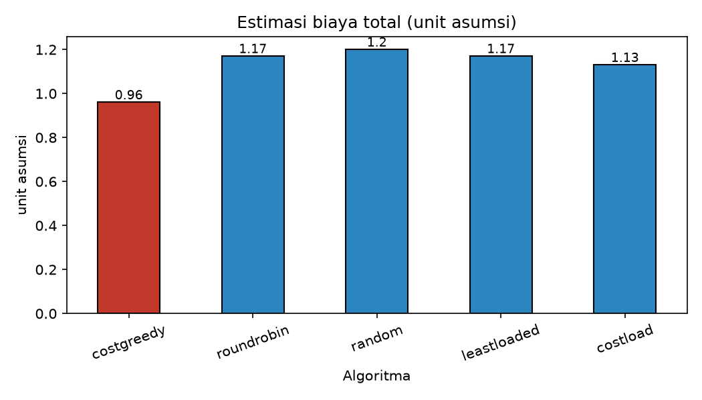
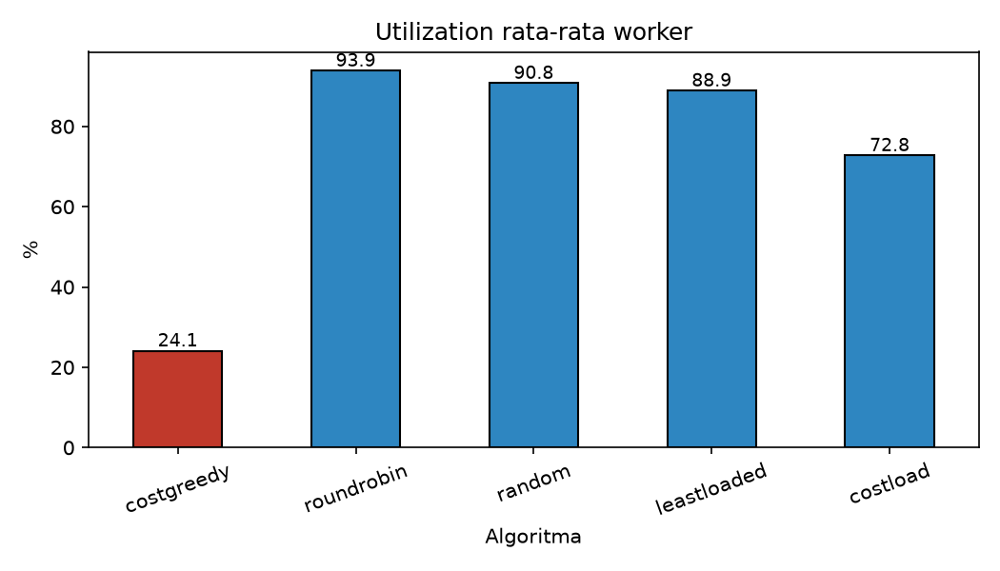
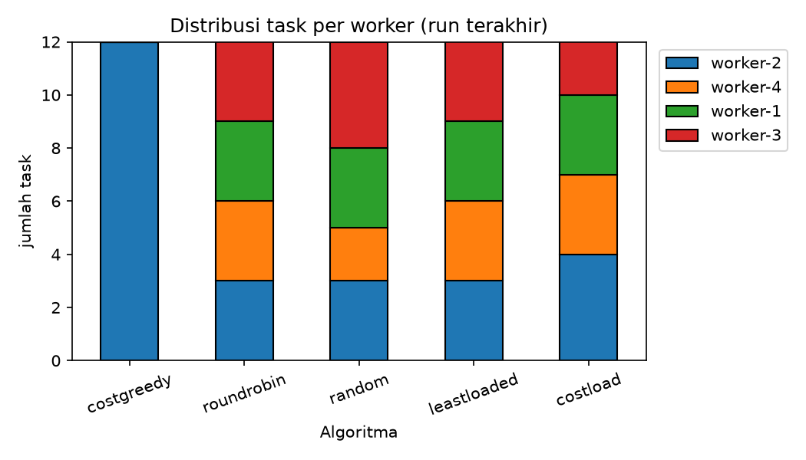

# Laporan Implementasi Real-World: Strategi Optimasi Penjadwalan Task di Komputasi Awan

**Mata kuliah:** Strategi Optimasi Komputasi Awan (SOKA), kelas B
**Kelompok / anggota:** **[ISI: nama dan NIM]**
**Tanggal:** 30 Oktober 2026

---

## Daftar Isi

1. [Pendahuluan](#1-pendahuluan)
2. [Arsitektur dan Lingkungan](#2-arsitektur-dan-lingkungan)
3. [Algoritma yang Dibandingkan](#3-algoritma-yang-dibandingkan)
4. [Metrik](#4-metrik)
5. [Hasil](#5-hasil)
6. [Analisis](#6-analisis)
7. [Keterbatasan](#7-keterbatasan)
8. [Kesimpulan](#8-kesimpulan)
9. [Cara Menjalankan Ulang](#9-cara-menjalankan-ulang)
10. [Struktur Repositori](#10-struktur-repositori)

---

## 1. Pendahuluan

Penjadwalan task di komputasi awan adalah masalah memilih mesin (worker) yang menjalankan setiap task. Pilihan itu memengaruhi biaya, waktu penyelesaian, dan seberapa merata beban terbagi. Laporan ini membandingkan beberapa strategi penjadwalan pada eksperimen nyata: scheduler dijalankan dari laptop, sedangkan task dieksekusi oleh empat worker di mesin virtual (VM) di cloud.

Tujuan eksperimen:

- Mengimplementasikan heuristik **CostGreedy** yang memilih worker dengan estimasi biaya terendah.
- Membandingkannya dengan tiga algoritma pembanding (Round Robin, Random, Least Loaded) dan satu varian usulan (**Cost-Load**).
- Mengukur trade-off antara biaya dan waktu dengan metrik yang sama untuk semua algoritma.

## 2. Arsitektur dan Lingkungan

Sistem terdiri dari tiga bagian:

1. **Scheduler (Java).** Memeriksa endpoint `/health` setiap worker, memilih worker sesuai algoritma, lalu mengirim task lewat HTTP `POST /run`. Semua task dalam satu batch dikirim bersamaan (paralel).
2. **Worker (Python).** Server HTTP yang menjalankan loop hash SHA-256 sebanyak jumlah iterasi pada task, lalu mengembalikan status, waktu eksekusi, dan checksum hasil.
3. **Jaringan.** Scheduler di laptop terhubung ke empat worker melalui SSH tunnel pada port lokal 9001 sampai 9004. Tunnel diteruskan lewat masing-masing host AWS ke guest VM di dalamnya.

### Topologi

Infrastruktur terdiri dari **dua host AWS EC2** (Ubuntu 26.04.1 LTS, kernel `7.0.0-1014-aws`). Setiap host menjalankan KVM/libvirt dan memiliki **dua guest VM**, sehingga total ada empat guest dan satu worker per guest.



| Worker | Guest VM | Host | IP guest (jaringan NAT libvirt) | Port tunnel di laptop |
|---|---|---|---|---|
| worker-1 | h1-vm1 | host 1 | 192.168.122.80 | 9001 |
| worker-2 | h1-vm2 | host 1 | 192.168.122.250 | 9002 |
| worker-3 | h2-vm1 | host 2 | 192.168.122.10 | 9003 |
| worker-4 | h2-vm2 | host 2 | 192.168.122.221 | 9004 |

Spesifikasi guest: Ubuntu 22.04 (cloud image), 1 vCPU, 1536 MB RAM, Python 3.10.12. Worker berjalan di port 8000 pada setiap guest, dan semua guest memakai file `worker.py` yang sama (checksum MD5 identik: `461b2f40001472995b9be4923df11e4e`). Pemeriksaan `/health` dari masing-masing host mengembalikan `healthy` untuk keempat worker.

Host 1 memakai mirror paket `ap-southeast-2`, yang menunjukkan region Sydney. **[ISI: konfirmasi region host 2, tipe instance kedua host (misalnya t3.xlarge), jumlah vCPU dan RAM masing-masing host, dari konsol EC2.]**

Parameter eksperimen:

| Parameter | Nilai |
|---|---|
| Jumlah task per batch | 12 |
| Iterasi per task | 1.000.000 |
| Jumlah worker sehat | 4 |
| Pengulangan | 3 run per algoritma |
| Seed Random | 42 (tetap) |

Parameter biaya per satu juta iterasi (**asumsi ilustratif, bukan harga billing**):

| Worker | Biaya |
|---|---|
| worker-1 | 0,10 |
| worker-2 | 0,08 |
| worker-3 | 0,12 |
| worker-4 | 0,09 |

## 3. Algoritma yang Dibandingkan

| Algoritma | Cara kerja |
|---|---|
| **CostGreedy** (heuristik utama) | Memilih worker sehat dengan estimasi biaya terendah: `biaya = (iterasi / 1.000.000) × biaya per juta iterasi`. Tidak melihat beban worker. |
| **Cost-Load** (varian usulan) | Memilih worker dengan nilai terendah dari `biaya × (jumlah task berjalan + 1)`. Worker murah tetap diutamakan tetapi tidak dibanjiri semua task. |
| **Round Robin** | Task dibagikan bergiliran ke setiap worker. |
| **Random** | Worker dipilih acak (seed tetap 42, sehingga pembagian task identik di setiap run). |
| **Least Loaded** | Memilih worker dengan jumlah task berjalan paling sedikit. |

## 4. Metrik

- **Makespan:** total waktu dari task pertama dikirim sampai task terakhir selesai (detik). Makin kecil makin baik.
- **Throughput:** jumlah task selesai per detik.
- **Estimasi biaya:** jumlah biaya asumsi seluruh task.
- **Utilization:** persentase waktu worker sibuk, dihitung dari gabungan interval task per worker lalu dirata-rata terhadap jumlah worker.
- **Latensi task:** waktu dari task dikirim sampai hasil diterima.

## 5. Hasil

Rata-rata dari 3 run (12 task, 1 juta iterasi per task):

| Algoritma | Makespan (s) | Throughput (task/s) | Estimasi biaya | Utilization (%) | Latensi rata-rata (s) |
|---|---|---|---|---|---|
| CostGreedy | 2,88 | 4,18 | **0,96** | 24,1 | 2,54 |
| Cost-Load | 2,76 | 4,53 | 1,13 | 72,8 | 1,87 |
| Least Loaded | 2,31 | 5,21 | 1,17 | 88,9 | 1,96 |
| Random | **2,08** | **5,76** | 1,20 | 90,8 | **1,84** |
| Round Robin | 2,22 | 5,40 | 1,17 | **93,9** | 1,99 |

Grafik:







Dashboard interaktif: buka `results/dashboard.html` di browser setelah menjalankan `analyze.py`.

## 6. Analisis

**Trade-off biaya dan waktu.** CostGreedy menghasilkan estimasi biaya terendah (0,96), sekitar 18% lebih murah daripada Round Robin (1,17) dan 20% lebih murah daripada Random (1,20). Harganya adalah waktu: makespan CostGreedy 2,88 detik, sekitar 29% lebih lama daripada Round Robin (2,22 detik) dan 38% lebih lama daripada Random (2,08 detik).

**Penyebabnya adalah penumpukan task.** CostGreedy hanya melihat biaya, sehingga seluruh 12 task dikirim ke worker-2, yang punya parameter biaya terendah. Grafik distribusi menunjukkan tiga worker lain menganggur dan utilization hanya 24,1%, kira-kira satu dari empat worker yang bekerja. Pada worker yang sama, task saling berebut CPU sehingga latensi per task naik.

**Algoritma yang menyebar beban lebih cepat tetapi lebih mahal.** Round Robin, Random, dan Least Loaded membagi task merata ke empat worker, sehingga utilization 89% sampai 94% dan makespan sekitar 2,1 sampai 2,3 detik. Konsekuensinya, task ikut jatuh ke worker yang lebih mahal sehingga biaya naik menjadi 1,17 sampai 1,20.

**Cost-Load: hasil campuran.** Cost-Load memberi biaya 1,13 (sekitar 3% lebih murah daripada Round Robin) dan utilization 72,8%, jauh di atas CostGreedy. Namun makespan rata-ratanya (2,76 detik) belum lebih baik daripada algoritma yang membagi merata. Angka itu terdorong oleh satu run yang lambat (3,62 detik); dua run lainnya sekitar 2,3 detik. Dengan hanya 3 run, belum bisa disimpulkan bahwa Cost-Load konsisten lebih baik atau lebih buruk.

**Random bukan yang terbaik secara pasti.** Random memiliki makespan terkecil, tetapi seed tetap membuat pembagian task identik di setiap run. Selisihnya dengan Round Robin (sekitar 0,14 detik) kemungkinan besar berasal dari variasi jaringan, bukan keunggulan algoritma.

**Pengamatan tambahan tentang CPU.** Satu task yang berjalan sendirian membutuhkan sekitar 0,16 detik, tetapi saat dijalankan bersamaan waktu eksekusi per task menjadi sekitar 1,2 detik, lebih tinggi daripada yang diharapkan jika empat worker punya CPU terpisah. Setiap guest hanya memiliki 1 vCPU, sehingga task yang berjalan bersamaan pada worker yang sama saling antre. Dua guest pada satu host juga berbagi CPU host tersebut. Ini hipotesis yang belum diverifikasi, dan menjelaskan mengapa penyebaran ke empat worker hanya mempercepat sekitar 23% sampai 28%, bukan empat kali lipat.

## 7. Keterbatasan

- Biaya adalah **asumsi ilustratif**, bukan harga billing cloud. Kesimpulan "lebih hemat" hanya berlaku pada model biaya ini.
- Hanya 3 run per algoritma, dan waktu diukur dari laptop sehingga ikut terpengaruh latensi SSH tunnel. Selisih kecil antar algoritma belum tentu signifikan secara statistik.
- Beban kerja berupa satu jenis task (hash SHA-256) dengan ukuran seragam; hasil bisa berbeda untuk beban yang heterogen.
- Task dikirim sekaligus, bukan datang bertahap seperti sistem produksi.
- Setiap guest hanya 1 vCPU dan 1536 MB RAM, dan dua guest berbagi satu host, sehingga kapasitas komputasi tiap worker kecil dan guest pada host yang sama dapat saling memengaruhi.
- Guest berada di jaringan NAT internal tiap host, sehingga laptop hanya dapat mengaksesnya lewat SSH tunnel; latensi tunnel ikut terukur pada makespan.

## 8. Kesimpulan

Eksperimen berhasil menjalankan scheduler Java dan worker Python pada VM cloud nyata, dengan seluruh task pada setiap run berstatus selesai. Hasilnya menunjukkan trade-off yang jelas: CostGreedy paling murah (0,96) tetapi paling lambat (2,88 detik) karena semua task menumpuk di satu worker, sedangkan Round Robin, Random, dan Least Loaded lebih cepat (2,1 sampai 2,3 detik) dengan biaya sekitar 18% sampai 25% lebih tinggi. Cost-Load menaikkan utilization dari 24% menjadi 73% dengan biaya 1,13, namun keunggulan makespan-nya belum terbukti. Pilihan algoritma bergantung pada prioritas: biaya minimum atau waktu minimum.

Saran pengembangan: tambah jumlah run (5 sampai 10), variasikan ukuran task, validasi biaya dengan data harga nyata, dan uji varian yang menyeimbangkan biaya dan beban dengan bobot yang dapat diatur.

## 9. Cara Menjalankan Ulang

Prasyarat: Java 11 atau lebih baru, Python 3, dan empat worker yang dapat diakses di port 9001 sampai 9004.

```bash
# 1. Jalankan worker (satu per terminal / VM)
WORKER_ID=worker-1 PORT=9001 python3 worker/worker.py

# 2. Compile scheduler
cd scheduler
javac TaskScheduler.java

# 3. Satu run: java TaskScheduler <algoritma> <jumlah_task> <iterasi> <file_csv>
java TaskScheduler costgreedy 12 1000000 ../results/runs/costgreedy_run1.csv
```

Algoritma yang tersedia: `costgreedy`, `roundrobin`, `random`, `leastloaded`, `costload`.

Menjalankan semua algoritma 3 kali (PowerShell):

```powershell
foreach ($r in 1..3) {
  foreach ($al in "costgreedy","roundrobin","random","leastloaded","costload") {
    java TaskScheduler $al 12 1000000 ..\results\runs\${al}_run$r.csv
  }
}
```

Membuat grafik, tabel, dan dashboard:

```bash
pip install pandas matplotlib
python analyze.py ../results/runs ../results
```

## 10. Struktur Repositori

```text
.
├── LAPORAN.md
├── scheduler/
│   ├── TaskScheduler.java        # scheduler multi-algoritma
│   ├── CostGreedyScheduler.java  # versi awal (CostGreedy saja)
│   ├── analyze.py                # metrik, grafik PNG, dan dashboard
│   └── dashboard_template.html   # template dashboard
├── worker/
│   └── worker.py                 # worker HTTP
└── results/
    ├── runs/                     # CSV mentah tiap run
    ├── summary_metrics.csv
    ├── chart_*.png
    └── dashboard.html
```
